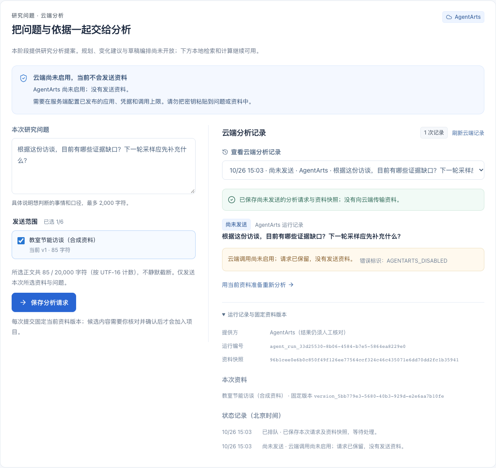
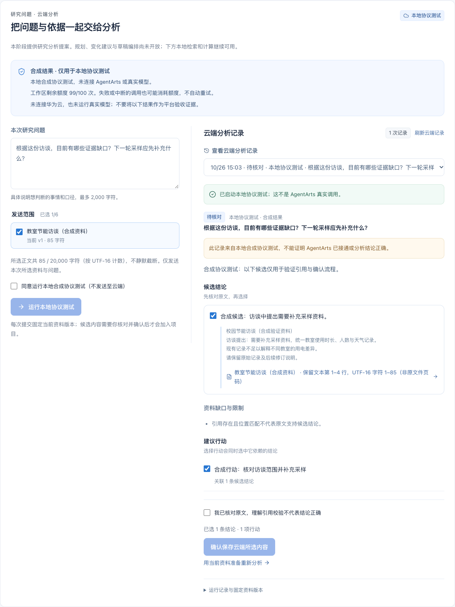
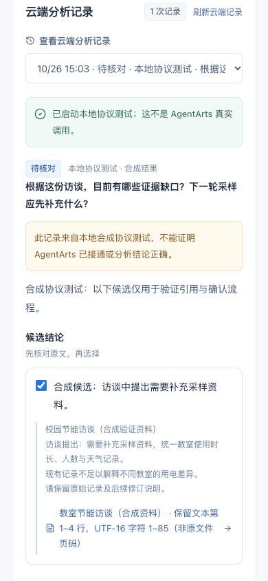

# 里程碑 A：云端分析协议、运行记录与证据校验

日期：2026-10-26。当前完成的是新分析协议、受控运行管理、前端核对和 AgentArts 调用准备。**本轮未配置团队发布态应用及调用预算，没有真实模型调用，也没有将里程碑 B 的真实连通性标记为通过。**

## 具体有什么用

此前分析只支持本地关键词和 CSV 工具。现在可以保存自然语言研究问题、固定本次资料范围，为平台返回的结构化结果建立可追溯记录；以后接通平台时，不需要让模型结果绕过原有证据和确认规则。

- **旧功能继续可用**：本地分析仍是原来的 `local-tools-v1`；旧项目无需清空或重算成云端结果。
- **每次运行有独立记录**：保存问题、资料版本、内容哈希、连续证据片段、发送授权、真实状态事件和确认回执。失败、中断和需要补充信息分别显示。
- **引用可核对**：模型仅选择本次快照已有的证据编号。后端核对编号、版本、原文与位置；不能自行填资料 ID、页码或坐标。查看时打开固定版本并高亮真实片段。
- **确认前不写入业务对象**：有效返回只是提案，用户选择结论和行动并确认后才加入项目。原始建议、旧资料、任务进度及报告历史保留；资料更新后不能确认旧提案。
- **不偷偷重复调用**：配置默认关闭；读取历史、刷新、启动服务和重启都不触发模型。发送前明确授权，一次调用先记入持久化尝试计数，无自动重试；丢失或无法读取回执时复用操作标识。

## 本轮可实际使用的流程

1. 打开「资料分析」。上方是云端分析入口，下方原有本地检索与计算仍可操作。
2. 在未配置状态下填写问题、选择资料，点击「保存分析请求」。页面明确显示「尚未发送」，保留请求及资料快照，未产生云端调用。
3. 可刷新查看历史，或用当前资料把问题带回输入区。此操作不自动重跑，不追认旧授权。
4. 后续按 [AgentArts 工作流与真实验收说明](AGENTARTS-WORKFLOW.md) 配置已发布应用、凭据与调用上限，再主动选择资料并授权发送。
5. 有真实返回后，先查看引用原文，选择所需内容并确认。服务端仍校验当前资料、选择依赖和重复提交。

合成协议提案仅在隔离测试服务中注入，生产页面没有切换模拟模型的开关。截图中的合成结果明确标注「本地协议测试」，不能用于证明平台已接通。

## 本轮范围与限制

当前只执行 `research`（研究问题分析）。`change_review`、`planning`、`draft` 已定义为协议意图，但尚不能提交执行。没有多轮会话编排、云端检索/计算工具、多 Agent、生产账号或公网部署；首条工作流采用用户授权的固定资料快照。

最多选择 6 份资料、合计 20,000 个 UTF-16 代码单元；超限不截断。片段按原文连续分块，保留 CRLF、Unicode 和精确字符位置，行号来自保存文本，不能当作原文件页码。引用匹配不证明结论含义正确，也不是数值计算或学术正确性认证。

工作区新增可选 `project.agentRuns`，原 `analyses` 的生成、读取和历史完整性校验不变。已有存储格式仍可读取；新版本写入云端运行记录后，回退到不认识该字段的旧程序前应先保留备份。本地数据及运行记录不进入 GitHub。

调用次数是**保守的派发尝试上限**，不是金额、Token 或平台实际计费次数；网络失败、取消或调用前的极端拒绝也可能占用一次标记。重启不重置工作区计数。停止本地等待不能保证云端立即停止执行或计费。缺少磁盘写入条件时停止派发，不在记录无法可靠保存时继续发送。

适配器按当前官方运行时事件和本项目结束节点约定编写，只接收有界 JSON/SSE 中的唯一完整结束结果；未知形态失败关闭。团队实际应用的响应仍需在 B 中用真实记录验证，不能将配置齐备、合成 HTTP 响应或软件测试当成平台验收。

## 验证记录

- `npm test`：174 项通过，含新增协议、原文定位、运行管理及模拟传输检查。
- `npm run build`：TypeScript 检查和 Vite 生产构建通过。
- 完整浏览器回归：40 条通过，含默认关闭、授权、逐项确认、响应丢失、过期资料、补充信息、无效引用、中断、历史恢复及 390px 页面。
- 增强 HTTP 200 回执损坏及 5xx 恢复后，4 条新增浏览器流程再次通过，保留原操作标识；返回问题区遵守减少动画偏好。
- 依赖审计 0 项漏洞；未新增依赖。独立只读审查补查了重启、派发计数、错误脱敏和存储失败收口。
- 截图来自隔离临时工作区与已有 Chrome，已逐张检查。测试传输全部为本地合成响应，真实云端调用次数为 0。

Windows/Linux 核心与构建、Linux 浏览器结果以本次提交对应 GitHub Actions 为准。未安装原生环境、SDK、模型或本地浏览器，未做实机或真实用户试用。

## 下一步：B 的真实连通性验收

需要已开通 AgentArts、可用模型、发布态工作流、服务端凭据和明确调用上限。按配置说明先用一次授权的合成材料运行，核对平台真实记录、最终响应、引用与页面；成功后才补记真实平台验收。公网工具、数据库与生产登录仍属于后续 C。

## 实际页面

