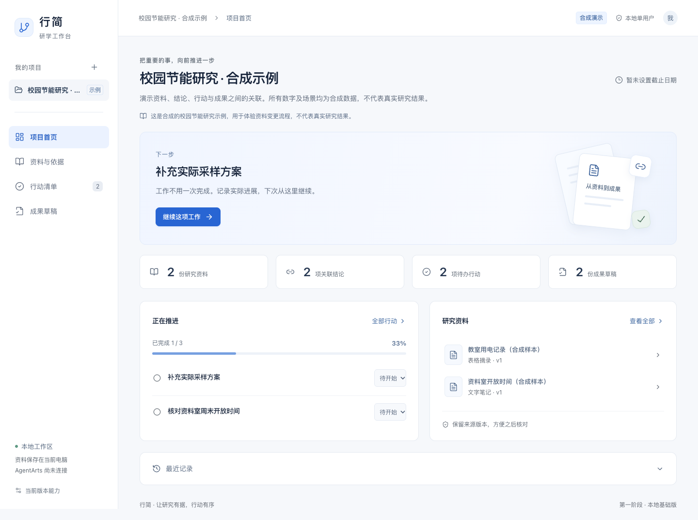
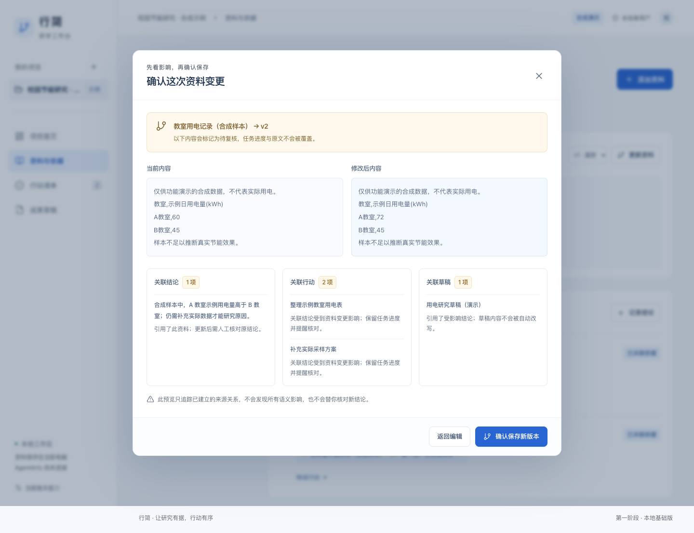

# 第一阶段交付记录

日期：2026-10-24（北京时间）。本阶段创建新仓 `haohao6666666/Xingjian-ICT-AgentArts`，私有、独立 Git 历史。没有向四个原仓推送，也没有改动它们的 main 或 dev/haohao。

## 具体作用

已有资料、结论、任务和成果不再各自孤立。用户修改一份资料时，可以先看到哪些已关联内容需要重新核对，确认后保留新旧版本；已完成任务仍保持完成状态，但会显示复核提醒。

这是后续 AgentArts 工具编排的数据基础，当前计算的是明确记录的关系，不是模型自动判断语义。

## 实现清单

- 新建研究项目，录入目标和可选截止日期。
- 纯文字资料登记、不可变版本历史与历史查看。
- 手工结论关联具体资料版本和用户填写的原文位置。
- 行动、完成进度和手工成果草稿；关联到同一项目结论。
- 资料变更预览、明确确认、局部影响传播；未关联内容保持原状态。
- 本机持久保存、工作区乐观版本锁、操作回执去重、原子替换。
- 同一数据文件的单写入进程锁。旧锁不自动抢占，避免并发恢复丢数据。
- 仅本机监听，限制 Host、Origin、客户端标识与请求体；开发服务不提供 `.runtime` 或 `.env` 文件。
- 白蓝桌面工作台、中文表单、键盘对话框、窄屏导航、错误与重试。
- 四仓来源提交、许可状态和后续适配边界已登记。

## 当前已完成的本地验证

环境：macOS，现有 Node.js 24 与已有 Google Chrome；未安装原生 SDK 或新的浏览器。

- `npm test`：33 项核心、存储、接口检查通过。
- `npm run build`：TypeScript 与 Vite 生产构建通过。
- `npm run test:browser`：5 条真实页面流程通过。
- `npm audit --audit-level=moderate`：本轮依赖审计报告 0 项已知漏洞；不是对软件安全的全面证明。
- 截图检查：1440px 桌面首页、变更预览、390px 资料页。浏览器窄屏检查无横向溢出；已调整正文/辅助文字尺寸和对比度、验证弹窗进入与退出焦点。

浏览器回归内容：

1. 新建项目→纯文本资料→结论→关联行动→草稿→刷新保留；HTML 文字不执行。
2. 预览取消不写入；确认后旧版本保留，仅关联内容待核对。
3. 其他页面抢先修改时拒绝旧确认，保留输入，重新预览后保存。
4. 服务端已保存但浏览器丢失响应时，重试使用原操作标识，不重复创建。
5. 390px 窄屏、减弱动画、键盘关闭弹窗与焦点归还。

GitHub 配置了 Linux/Node 22、Windows/Node 24 的核心测试与构建，以及 Linux 浏览器测试。**远程结果以本提交对应的 [Actions](https://github.com/haohao6666666/Xingjian-ICT-AgentArts/actions/workflows/ci.yml) 为准**，不将本机通过当成 Windows 通过。

## 明确尚未实现

真实 AgentArts/云模型、自动解析 PDF/Word/表格、语义检索、自动排期、课表、继续点、正式报告导出、JATS/PDF 编译、多人身份授权与云部署。

目前尚不能编辑既有结论并形成新结论版本，也不能完成复核并解除影响提醒；第一阶段先证明变更不会被悄悄忽略。后续复核必须记录新的依据与版本，不能只增加一个“全部已读”按钮。

没有执行实机或 DevEco 编译；当前工程是 Web/Node 基础版，不需要这些环境。本阶段没有付费模型调用。

## 界面截图

全部截图使用明确标注的合成示例，属于本阶段运行页面，不是实际研究成果。
