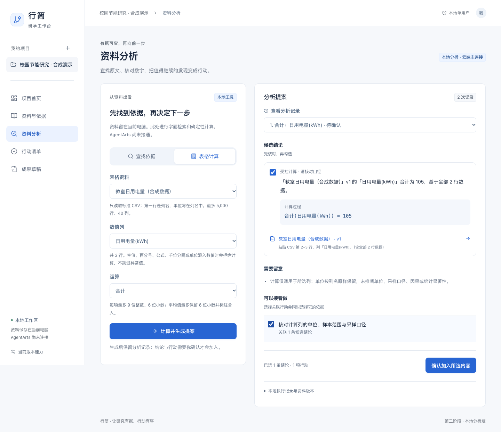
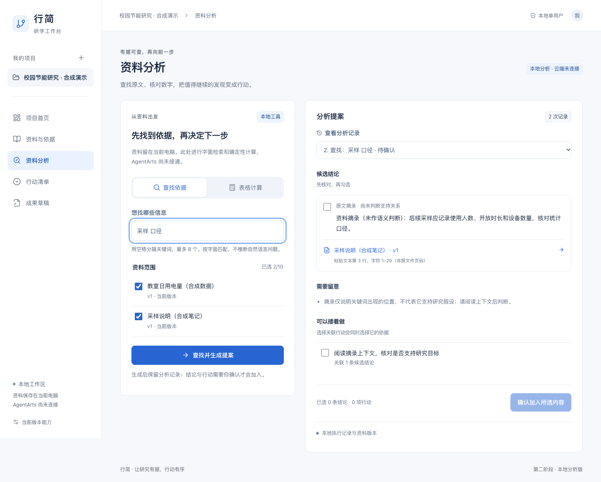

# 第二阶段本地部分交付

日期：2026-10-24。用户明确确认「尚未开通，先完成本地部分」。本轮完成本地分析与提案闭环；AgentArts 真实构建、部署、调用和评测仍未完成，不以本地规则替代参赛平台要求。

## 这次具体能做什么

1. 在选定资料中查找关键词，生成带原文位置和版本的摘录；没有匹配时给出补充资料建议。
2. 对标准 CSV 的完整数值列计算合计、平均、最小、最大或个数，展示运算和覆盖行数；异常数据拒绝计算。
3. 先检查分析提案，选择需要的结论和行动，再确认写入。任务关联对应结论，结论保留资料版本。
4. 资料变更后，旧提案提示重新分析；已确认的内容继续收到原有复核提醒。确认丢失响应后可安全重试。
5. 查看历史分析、回到依据原文；刷新保留当前项目和页面，修复多项目刷新后跳错项目的问题。

新增独立「资料分析」入口，沿用白蓝界面。桌面两栏分别填写输入和核对提案；窄屏纵向排列。按钮状态、错误重试、结果焦点、空资料与无匹配均有实际行为。

## 与四仓和云平台的关系

本轮只修改新仓的 `feat/phase-02-local-analysis`，不修改四个原仓，也不覆盖新仓 main。新代码依据已固定的知衡资料版本、证据定位与范围校验边界编写；没有迁入知衡完整 Python/向量/模型服务，没有将本地运行记录包装成 AgentArts 轨迹。

未使用云密钥、未调用付费模型、未安装原生环境、未进行实机验证。仍是本机单用户，不能直接开放公网。

## 本地验证

- `npm test`：51 项核心、存储与接口测试，覆盖新旧流程。
- `npm run build`：TypeScript 检查与 Vite 生产构建。
- `npm run test:browser`：8 条真实 Chrome 页面流程，包括新增分析、确认丢包重试、过期资料重新分析、无匹配任务、错误恢复、390px 页面及旧流程回归。
- `npm audit --audit-level=moderate`：0 项已知依赖漏洞；未新增运行依赖。
- 截图核对：1440px 计算提案与依据检索、390px 分析页，无横向溢出。截图全部为合成资料。

本地环境为现有 macOS/Node 24/Chrome。CI 分别运行 Linux/Node 22、Windows/Node 24 的测试/构建，以及 Linux 浏览器测试。远程结果以[当前分支 Actions](https://github.com/haohao6666666/Xingjian-ICT-AgentArts/actions?query=branch%3Afeat%2Fphase-02-local-analysis) 对应提交为准，不将本机结果写成 Windows 已通过。

关键回归：精确小数与舍入、CSV 引号/换行/空记录、异常值拒绝、UTF-16 摘录定位、跨项目/身份隔离、资料指令不执行、选择依赖校验、历史版本重算、旧数据兼容、重复确认/重启回执和状态原子性。

## 后续优先项

第三阶段先补「待复核」的完整处理：对照新旧依据，确认新的结论版本，逐项更新对应行动和草稿；保留旧结论和原引用，不直接清空提醒。随后增加实际任务继续点和计划预览。AgentArts 开通后，单独完成真实只读工具调用、权限与运行证据，再进行云端完整闭环。

## 实际页面

接口和限制见 [第二阶段契约](phase-02-contract.md)。
