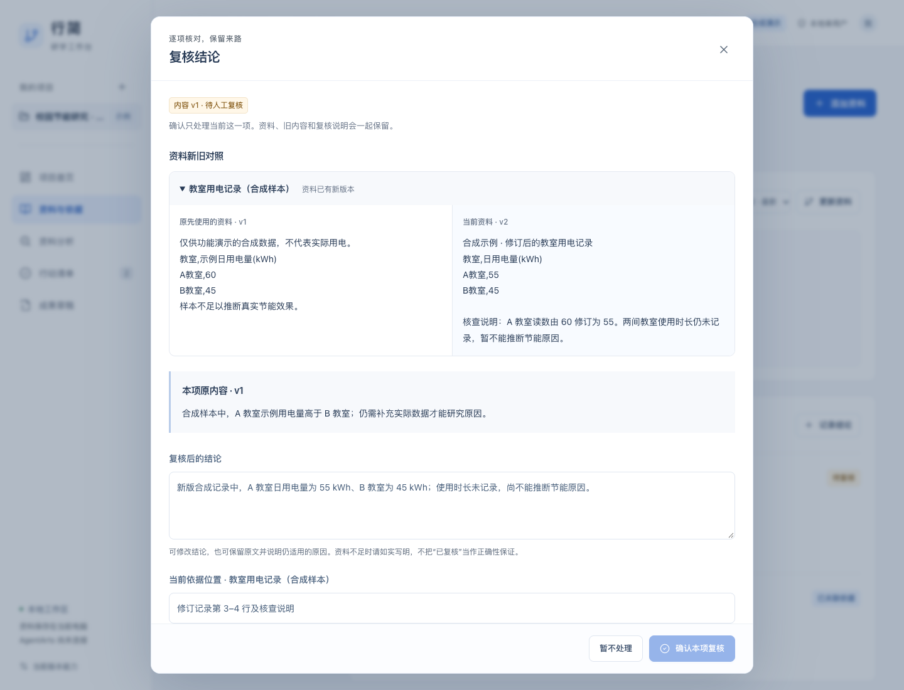
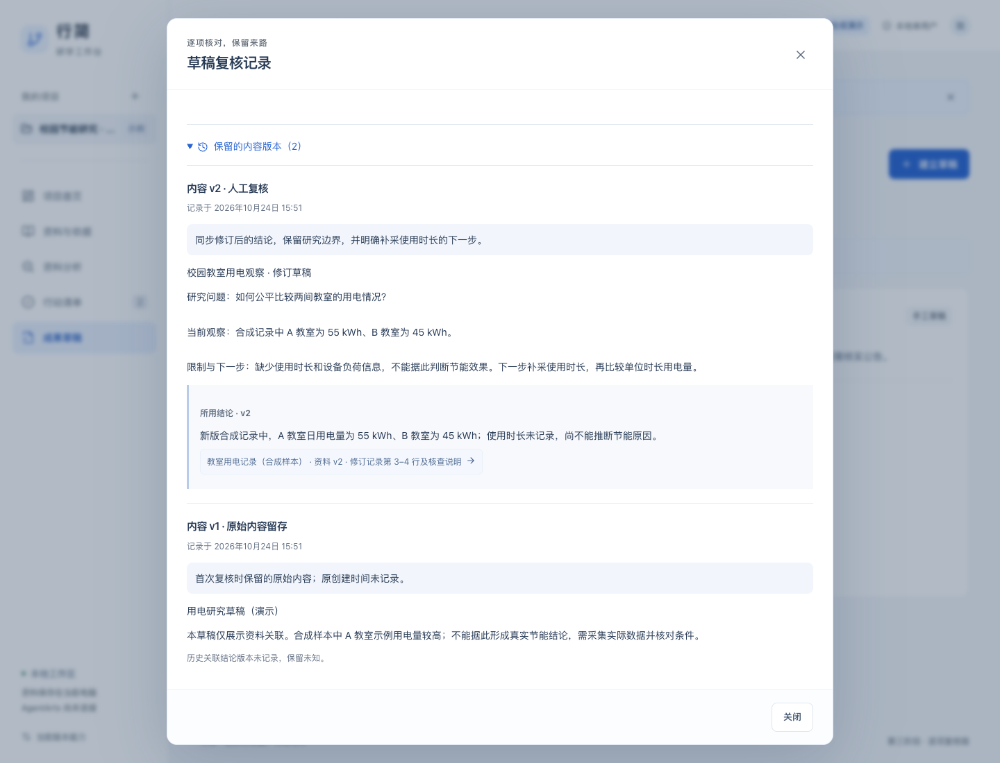

# 第三阶段 A：资料变化后的逐项复核

日期：2026-10-24。本轮只完成结论、行动和草稿的复核闭环。自动排期、任务继续点、AgentArts 接入与成果排版仍是后续工作。

## 使用价值

资料更新后，可以对照原资料和当前资料，修改结论或说明为什么仍适用；每次确认留下新内容版本、说明和依据。复核结论不会把下游工作直接认定为已处理，行动和草稿还需要分别核对。

- **结论**：查看新旧资料，核对依据位置，填写人工复核说明。原文和原引用保留。
- **行动**：先处理尚待复核的关联结论，再核对行动内容。已完成任务仍保持已完成，未完成任务也不会被自动完成。
- **草稿**：结合当前结论更新标题和正文。旧草稿、当时使用的结论和资料版本可从复核历史重新打开。
- **恢复**：资料在填写期间再次变化时，阻止旧确认，保留输入，并要求重新对照；保存响应丢失后重试不会增加重复版本。

界面沿用白蓝工作台：桌面并排对照、窄屏上下对照；保留错误重试、键盘焦点、Escape 取消和明确的单项确认。原始记录没有结论版本时显示“原关联版本未记录”，不把最新结论当作历史依据。

## 体验步骤

1. 「体验一个示例」→「资料与依据」→更新合成用电资料，预览影响并保存。
2. 从项目总览「开始逐项复核」或结论卡片「逐项复核」进入。核对新旧资料，填写结论、依据位置和说明，勾选已核对，再确认。
3. 打开「行动清单」，分别处理待复核行动。若还有关联结论未处理，会显示原因及跳转入口。
4. 打开「成果草稿」，修订正文后确认。复核只改变这一份草稿。
5. 打开「复核记录」，查看旧内容、复核说明及当时的结论/资料。再次更新资料后，关联内容会重新进入待复核。

## 本地验证与边界

- `npm test`：70 项核心、存储和 HTTP 测试通过，包含多来源完整性、依赖阻断、过期预览、再次更新、进度保持、历史完整性及旧分析记录兼容。
- `npm run build`：TypeScript 检查与 Vite 生产构建通过。
- `npm run test:browser`：12 条真实 Chrome 页面流程通过，覆盖旧功能和本阶段逐项确认、历史依据跳转、丢包重试、填写期间资料变更、预览失败恢复、390px 布局与键盘操作。
- 本机为 macOS，使用已有 Node 与 Chrome；没有安装原生 SDK、调用模型或进行实机验收。未新增运行依赖。

远程 Linux/Windows 测试与构建、Linux 浏览器测试以[本阶段 Actions](https://github.com/haohao6666666/Xingjian-ICT-AgentArts/actions?query=branch%3Afeat%2Fphase-03-review-workflow) 对应提交为准，不将本机结果替代远程验证。

本轮仅修改新仓 `feat/phase-03-review-workflow`。四个原仓与新仓 main 保持原样；分支基于第二阶段，若第二阶段尚未合并，本阶段 PR 依赖它。

“已人工复核”只记录用户确认，不是自动事实判定。系统只追踪显式关系，不自动判断所有语义影响。当前阶段不支持复核时增删原资料关联，也不自动重算历史分析或改写旧提案。仍是本机单用户工作台，AgentArts 尚未连接，不能视为完成平台参赛要求。

## 实际页面

截图使用合成示例，不包含个人资料。

数据与接口见 [复核契约](phase-03-contract.md)。下一步为真实任务继续点和计划预览，另行实施。
