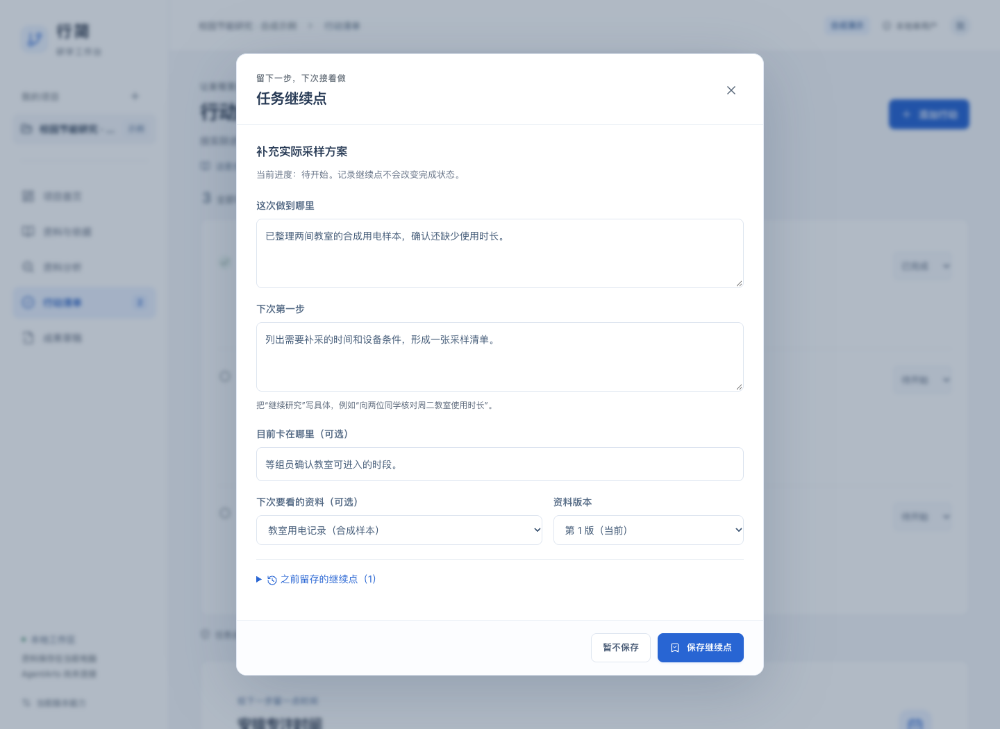
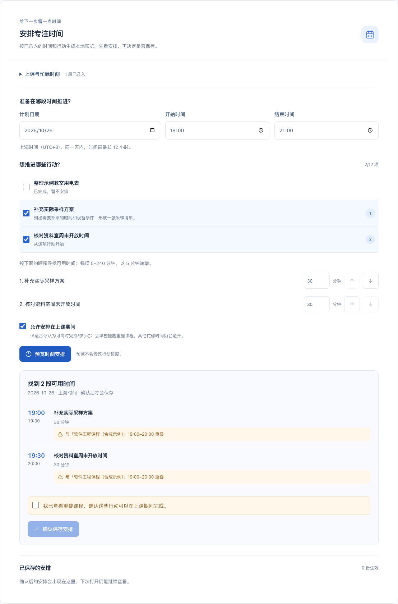

# 第三阶段 B：任务继续点与计划预览

日期：2026-10-25。新增功能集中在「行动清单」：把已复核的工作继续推进，并为下一步留出具体时间。沿用白蓝界面，不增加新的主导航或无用途仪表盘。

## 具体有什么用

- **中断后能接着做**：记录这次做到哪里、下次第一步和当前障碍；可关联一份资料的具体版本。重开页面恢复最新继续点，历史记录和原资料入口保留。
- **安排前先看是否可行**：选择日期、时间窗口、行动顺序和所需时长，预览时间块。已完成、待复核或没有足够连续时间的任务，会分别说明未安排原因。
- **课程安排由人决定**：可按具体日期录入课程/忙碌时段。默认避开上课；开启课内安排后，如实际重叠，还要核对课程并单独确认。其他忙碌时间和已确认计划始终避开。
- **跨项目不重复占时间**：同一用户各项目已录入的时间占用参与计算。新增占用与已保存安排冲突时提示重新检查，不静默改期。
- **失败后能恢复**：继续点/计划过期会保留填写，要求核对最新记录或重新预览；保存响应丢失可复用原操作重试，避免重复写入。

继续点和计划均不自动改变任务进度或解除复核提醒。已保存计划保留原始标题、任务/继续点版本、资料版本和课程重叠信息；取消释放时间但保留历史。

## 推荐演示

1. 载入合成示例，在「补充实际采样方案」记录下次第一步并关联原始资料。
2. 重开页面，检查继续点和原资料入口仍在。
3. 录入一段示例课程，选择两个行动：先预览避开上课的安排，再主动开启课内安排，展示重叠提醒与确认步骤。
4. 确认保存后，修改相关资料。原任务继续点和计划保留，界面提示复核；过期计划提案不能直接写入。
5. 取消不适用安排并重新预览，检查历史没有消失，任务状态没有自动完成。

## 验证记录

- 本地 `npm test`：88 项核心/存储/HTTP 测试通过，新增日期合法性、宿主时区独立、跨项目冲突、身份隔离、课程确认、部分可安排、历史/幂等/重启及原分析记录兼容。
- 本地 `npm run build`：TypeScript 检查和 Vite 生产构建通过。
- 本地 `npm run test:browser`：19 条 Chrome 页面流程通过，包括继续点、计划及之前分析/复核流程；覆盖断网重试、过期确认、历史资料、取消恢复、390px 布局和键盘焦点。
- 已用合成数据检查桌面和窄屏实际页面。使用电脑已有 Node/Chrome，未安装原生 SDK，未进行实机验证或模型调用。

GitHub 的 Windows/Linux 测试与 Web 构建、Linux 浏览器测试，以 [hw Actions](https://github.com/phoenix-chenli/hw/actions) 中本次 main 提交为准，可通过提交页面关联的 Actions 查看，不把本地通过等同于远程通过。

## 边界与后续

所有日期时间采用北京时间（Asia/Shanghai）。计划按选定顺序查找每项任务的最早连续空闲，是确定性本地规则，不是模型自主规划或最优调度证明；可能先放置重要任务，再用剩余较早空隙放入小任务。仅检查已录入数据，不声称掌握完整课表。允许记录过去日期，供回顾使用。

当前每个时间窗同日、最长 12 小时；一次最多 12 项、每项 5–240 分钟。每任务最多 100 个继续点，每项目最多保留 200 条时间占用和 100 份计划（含停用/取消历史）。取消后重新预览，尚无单个时间块改期/拆分、学期重复课表、计时器、提醒、个人日历、团队协作或真实 AgentArts。

用户指定的 `phoenix-chenli/hw` main 同步目录为 `xingjian-workbench/`，保留仓库原有 Word。只公开本独立工程与说明，不复制原四仓代码、个人资料、运行数据库、依赖目录或私有 Git 历史。下一步优先固定模板成果导出；AgentArts 真实接入仍是参赛必要待办，不能用本地功能替代。

## 实际页面

接口细节见 [第三阶段 B 契约](phase-03b-contract.md)。
