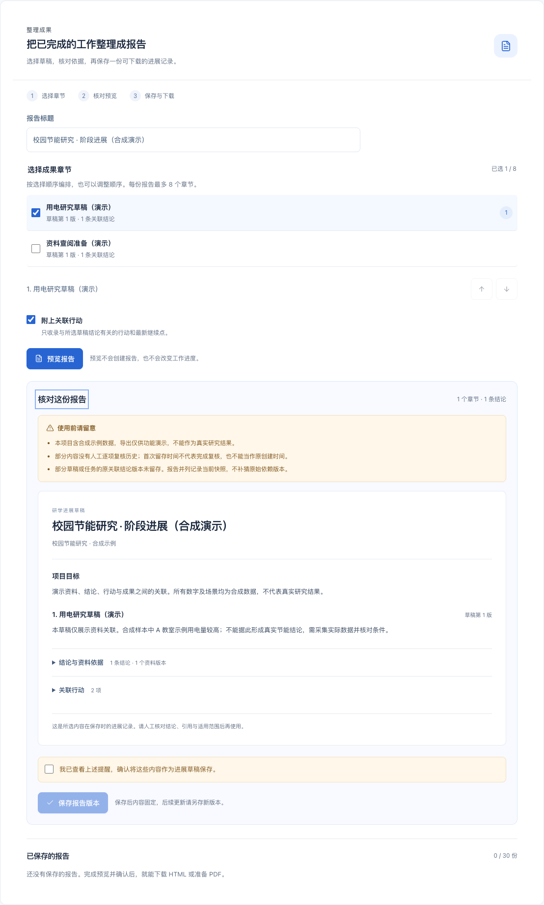
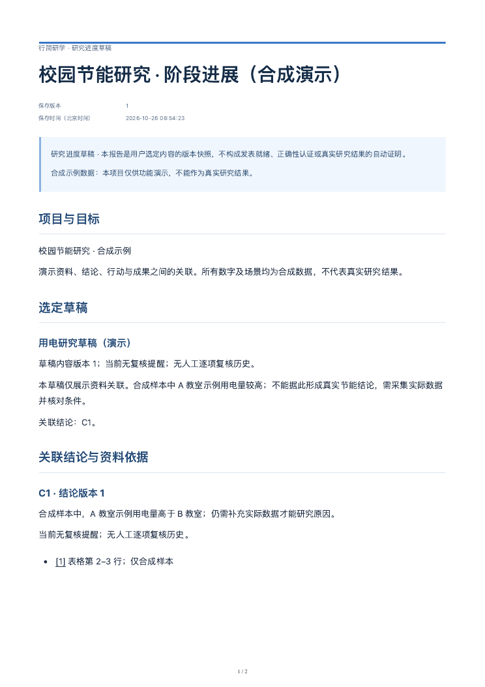
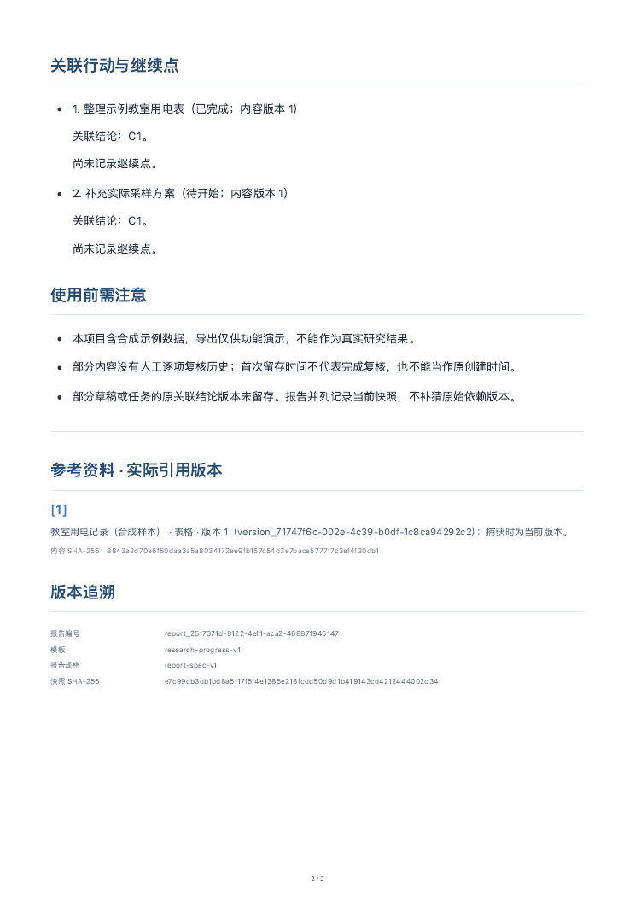

# 第四阶段：固定模板成果导出

日期：2026-10-26。本阶段把「资料版本 → 结论依据 → 行动 → 草稿」整理成可下载的研究进展记录。入口位于「成果草稿」列表下方，沿用白蓝界面和先预览、再确认的操作方式。

## 具体有什么用

- **从工作记录整理出报告**：选择草稿、调整章节顺序，按需附上关联行动与最新继续点；系统汇总这些章节直接关联的结论和实际引用版本，不带入无关草稿或资料全文。
- **保存当时的内容**：报告保存为独立版本。后续资料、结论或任务变化时，旧报告仍保留原文、依据、任务状态和引用版本；需要最新内容时另存新版本。
- **导出前知道缺什么**：预览列出待复核、缺少人工复核历史、原关联版本未知、未关联结论、历史资料引用及合成数据提醒。存在提醒时须主动确认，导出不清除复核标记，也不把任务改为完成。
- **可以交给别人看**：直接下载离线 HTML，或使用电脑已有的 Chrome 准备 A4 PDF。PDF 失败不影响报告版本和 HTML 下载；技术详情中另提供 JATS XML 与完整 JSON。
- **中断后能恢复**：写入过期会保留填写并要求重新预览；保存响应丢失时沿用原操作重试，避免多存一版。PDF 准备状态与完成文件保存在本机，重开页面可继续查询和下载。

这些产物是研究进度草稿。人工确认记录不等于结论正确、满足投稿规范或已经发表；没有自动补写作者、日期、DOI、期刊信息和资料页码。

## 推荐演示

1. 载入合成示例，打开「成果草稿」，在下方报告区域填写标题、选择章节并调整顺序。
2. 点击「预览报告」，核对草稿版本、关联结论、引用资料和提醒；尚未保存，不会改变项目数据。
3. 确认提醒后点击「保存报告版本」。在已保存报告中查看内容，下载 HTML。
4. 点击「准备 PDF」，就绪后手动下载；生成期间可继续其他工作，回来后查询状态。没有 Chrome 时可先使用 HTML。
5. 更新相关资料。已保存报告提示相关内容有变化，旧文件仍能下载；重新预览并保存下一版，比较两份内容与引用版本。
6. 可用两个页面模拟并行修改：旧预览保存时被拦截，原标题、选择与顺序保留，重新预览后再确认。

## 输出与环境

固定模板为 `research-progress-v1`：项目与目标、所选草稿、关联结论与依据、行动与继续点、使用提醒、实际引用版本、版本追溯。HTML 首部显示报告版本与北京时间，技术编号和哈希放在末尾。PDF 使用 A4 打印布局和页码；中文采用系统已有字体，未从网络下载字体。

导出链路为 **版本化 ReportSpec → 受限 JATS 1.3 标签 XML → 实际 XML 解析 → 离线 HTML → 独立 Node worker 打印 PDF**。新增运行时 JavaScript 依赖 `@xmldom/xmldom@0.9.12` 与 `playwright-core@1.61.1`。未安装原生 SDK、浏览器或整套 JATSCraft 环境；HTML/JSON/XML 导出不依赖浏览器。

PDF 默认调用电脑已有的 Chrome。`XINGJIAN_PDF_BROWSER=chromium` 仅用于已经配置好 Chromium 的 CI/worker，不会自动安装浏览器。同一服务一次只运行一个 PDF worker，生成时限 60 秒，产物上限 12 MiB。超时或服务关闭会取消，并等待 worker 退出清理；清理完成后才能重试，避免旧任务和新任务同时写入。

PDF 和 `job.json` 位于数据文件路径追加 `.exports` 的缓存目录，默认 `.runtime/workspace.json.exports/`。子目录由身份、项目和报告 ID 的哈希生成，不采用用户输入的文件路径。文件与报告内容哈希绑定，保存后的 PDF 校验失败会要求重新生成；服务重启后遗留的运行中任务标记为失败，允许重试。备份真实数据时也应保留需要的导出缓存，不能上传运行数据库或用户报告。

## 本阶段验证记录

- 本地 `npm test`：112 项核心、存储、HTTP 与 PDF 任务测试通过，含旧功能回归、内容版本校验、历史报告、XML 限制、清理竞态和导出复杂度。
- 本地 `npm run build`：TypeScript 检查与 Vite 生产构建通过。
- 本地 `npm run test:browser`：26 条流程通过，含真实 Chrome PDF 下载、章节排序、提醒确认、过期拦截、历史 HTML 一致性、响应丢失重试、纯文本转义、390px 与键盘。
- 用合成项目在实际页面下载并检查了 2 页 A4 PDF：中文可提取，标题、正文、提醒、参考资料、版本追溯与页码保留；逐页渲染检查了边距、换行及行动条目不拆页。桌面与窄屏页面也已检查。示例文件见下方。

GitHub Windows/Linux 构建和浏览器检查以 [hw Actions](https://github.com/phoenix-chenli/hw/actions) 中对应 main 提交为准；不把本地结果冒充远程结果。所有测试资料均为合成数据，没有模型调用、AgentArts 调用或实机验收。

## 边界与下一步

每项目最多 30 份报告快照；每份 1–8 个草稿章节，总文本最多 60,000 字符，最多 80 条结论、80 项关联任务、100 个资料版本对。超过限制直接说明原因，不静默裁剪。引用只记录实际使用的版本和位置，不复制资料全文。

段落、空行或引用结构复杂度超限时，也会在预览阶段明确拒绝，不截断正文，避免保存后才发现无法导出。

这是新增的受限格式适配，尚未接入上游完整 JATSCraft 引擎，也未做 JATS DTD 校验、期刊模板验收、参考文献元数据补全、可编辑 Word 导出或自动语义写作。AgentArts、真实云模型、团队权限和线上部署仍待完成，本地功能不能替代赛题要求的平台构建、编排与部署。

本阶段源代码归档分支为 `feat/phase-04-report-export`。按用户授权同步到 `phoenix-chenli/hw` 的 main，工程位于 `xingjian-workbench/`，原有 Word 保留；不修改原四仓。下一步可围绕证据定位、差异查看、失败恢复开展交互深化与真实研究小组试用，再依据实际观察迭代。

详细字段、校验与 API 见 [第四阶段契约](phase-04-contract.md)。

## 实际页面与导出样例

[下载合成示例 PDF](examples/sample-progress-report.pdf)。这是通过页面保存、独立 worker 生成并实际下载的演示文件；不是实际调研成果。

接口与模板参考：[NLM JATS 1.3 article 标签](https://jats.nlm.nih.gov/publishing/tag-library/1.3/element/article.html)、[Playwright PDF 接口](https://playwright.dev/docs/api/class-page#page-pdf)、[xmldom 文档](https://github.com/xmldom/xmldom)。本工程的受限子集不等同于这些标准的完整实现。
