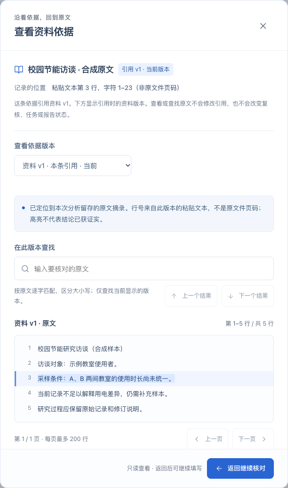
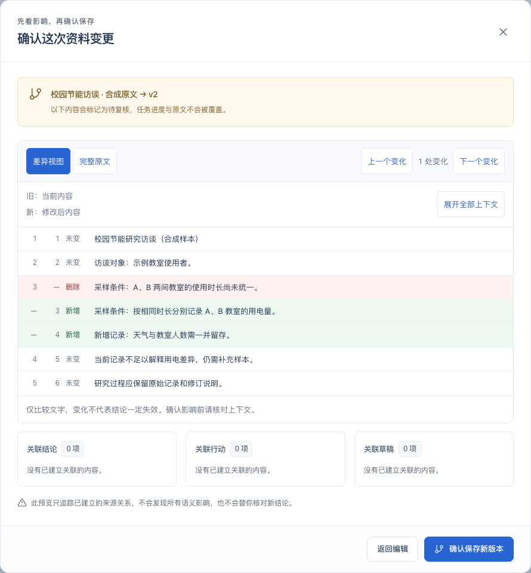
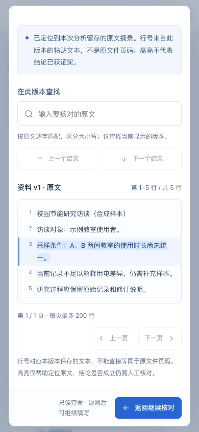

# 第五阶段 A：证据定位与资料差异对比

日期：2026-10-26。本阶段帮助用户在核对结论、修改草稿时更快回到原文，并看清资料更新了哪里。范围是本地只读交互，不包含真实研究小组试用，不代表第五阶段全部完成。

## 具体有什么用

- **核对时不用离开当前工作**：从分析提案、结论、行动、继续点、复核或报告打开资料依据，原地查看引用版本，返回后继续填写。打开依据不会关闭原复核/继续点窗口，也不清空未确认的输入和选择。
- **能定位就准确显示，不能定位就说明**：显式本地分析候选或已接受结论映射中的原文、版本和 UTF-16 坐标全部吻合时，显示对应高亮；CSV 计算显示实际记录占用的物理行范围。手工输入的定位描述不被猜成页码或行号。
- **资料换版后仍能追溯**：默认查看引用时的固定版本。可主动查看当前版本或对比两个版本；原引用不变，旧版高亮不会自动套用到新版。报告预览和历史快照也可打开固定版本依据，已保存报告内容及哈希保持不变。
- **自己查原文、看具体变化**：版本内查找采用区分大小写的字面匹配；差异标明新增、删除、旧新行号，并提供逐处导航、展开上下文和完整原文模式。材料历史、更新预览及逐项复核共用同一差异组件。

## 推荐演示

1. 载入合成示例，生成本地分析提案。在尚未确认提案时打开一条候选的资料依据，核对原文，返回继续选择。
2. 打开手工填写定位描述的依据。界面保留描述并说明定位精度；在「在此版本查找」搜索一段实际原文，通过上一个/下一个结果定位。
3. 更新一份已关联资料，在保存前查看差异；取消更新后，原资料和关联状态保持不变。再确认保存新版本，打开逐项复核。
4. 在复核窗口中先填写说明，再打开原版依据，显式切换当前版本或对比文字；返回后确认刚才填写仍在。
5. 在资料历史中选择不同版本比较，也可选择同一个版本确认「两个版本内容完全一致」。打开旧报告的依据，检查当时使用的版本仍可读取。

所有演示使用合成资料，不代表实际调研成果或真实用户试用。

## 定位与差异的边界

高亮只说明文字与可验证的记录对应，不证明资料支持某个结论，也不自动发现语义影响。当前行号对应本版本保存的文本，不能等同于 PDF、Word 或原始文件页码。缺少可验证位置时保持未知；缺失的资料或版本明确报错，不改用其它来源。

字符位置使用原始 UTF-16 半开区间，保留 CRLF、孤 CR、Unicode 与尾部空行；不先规范化换行再套用旧坐标。CSV 行范围可能跨多行记录，不能将记录序号直接冒充物理行号。查找内容只在当前显示版本本地使用，不写入 URL、浏览历史或业务数据。

版本内查找最多返回前 200 个匹配，存在更多结果时明确提示。正文与差异每页最多 200 行，完整内容逐页可读；完整原文左右对照在窄屏上下排列。小范围差异采用有工作量上限的行匹配；大段变化超过预算时，保留相同开头和结尾，将中间明确显示为整段删除/新增。原文不静默截断，换行符或末尾换行改变也会提示。

本阶段没有修改持久化 schema、分析算法、已保存提案、任务完成状态或报告内容。HTTP 能力标记为阶段 5，并增加 `evidenceInspection` 和 `sourceComparison`；这不表示 AgentArts 已接通。

## 验证记录

- 本地 `npm test`：124 项核心/存储/HTTP/PDF 管理及文本检查测试通过。新增原始坐标、字面查找上限、行差异重建/工作量限制、候选与已接受结论的版本定位测试。
- 本地 `npm run build`：TypeScript 检查和 Vite 生产构建通过。
- 本地 `npm run test:browser`：32 条流程通过，包含既有分析、计划、复核和报告回归，以及本阶段 6 条定位/差异流程。覆盖 600 行资料的自动定位与分页、200 条查找上限、长文降级、嵌套窗口保留输入、历史引用、取消更新、键盘焦点、390px 长行和恶意文本纯文本展示。
- 依赖审计 0 项漏洞。已用合成数据检查桌面与窄屏实际截图；独立只读复核额外验证随机行差异重建，没有据此虚构真实用户试用结果。

远程 Windows/Linux 构建与浏览器检查以 [hw Actions](https://github.com/phoenix-chenli/hw/actions) 对应 main 提交为准。无新依赖、原生环境安装、实机验证、云模型或 AgentArts 调用。

## 交付与后续

源代码归档分支为 `feat/phase-05a-evidence-diff`；按用户授权同步到 `phoenix-chenli/hw` 的 main，工程仍在 `xingjian-workbench/`，保留仓库原有 Word。四个原仓不修改。

后续可依据真实研究小组的使用观察继续打磨核对流程；平台构建、编排、部署与真实效果评测仍需开通 AgentArts 后完成。本地证据查看不能替代赛题要求的平台接入。

## 实际页面

截图来自本地实际运行的合成项目；没有上传个人资料或运行数据库。
