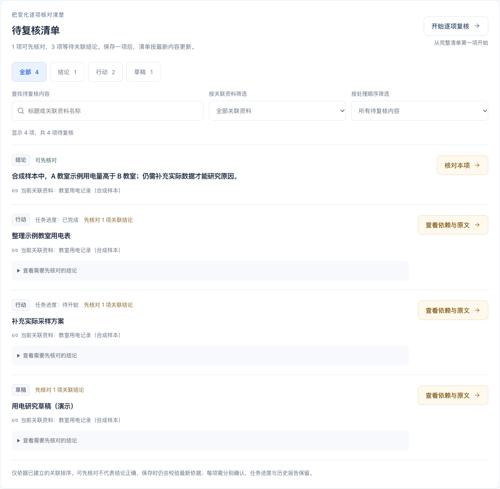
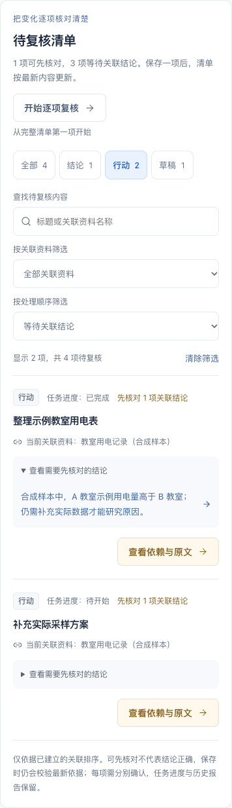

# 第五阶段 B：待复核清单

日期：2026-10-26。本阶段把分散在结论、行动和草稿中的待复核提醒集中到项目首页，让使用者能看清剩余事项、关联资料与处理顺序。

## 具体有什么用

- **先看清还有什么**：只列出当前仍标记待复核的内容；已完成但需要核对的行动仍显示「已完成」，不混淆复核与工作进度。
- **先处理依赖，再处理下游**：可先核对项在前，等待关联结论的项在后。展开依赖可直接打开具体结论；也可查看行动或草稿的依赖与原文。多结论依赖逐项解除，不能一键抹去下游提醒。
- **资料多时更好找**：支持内容类型、当前关联资料、可先核对/等待结论及文字组合筛选。文字对标题和资料名称作不区分大小写的字面匹配，不解释为正则或指令。清单每页最多 8 项，可继续翻页；没有匹配与确实没有待复核内容分别说明。
- **核对一项后接着工作**：保存后自动更新清单中的剩余标记与依赖提示，用户主动选择下一项。取消返回原按钮；保存使入口消失时回到清单标题。原地查看证据、冲突与响应丢失恢复继续可用。

## 推荐演示

1. 载入合成示例，更新示例教室用电资料，确认保存新版本后回到项目首页。
2. 查看「待复核清单」中的结论、行动和草稿。找到已经完成的整理行动，确认它仍显示完成进度，并提示先核对关联结论。
3. 按行动类型或资料筛选，再用文字查找。没有结果时清除筛选；这些操作不会改变资料、引用或复核状态。
4. 展开行动的依赖，打开其中一条结论。查看新旧资料原文，填写复核说明并确认。
5. 返回清单：结论已移出，但行动和草稿仍在，需要分别核对。任务进度、旧引用、历史内容和报告保持原样。
6. 分别确认剩余项。完成后看到「当前没有待复核内容」，刷新后已保存结果仍在。

演示与截图仅使用明确标注的合成资料，不代表真实用户试用或实际研究结果。

## 数据与交互边界

`shared/review-queue.mjs` 是只读派生层：从当前项目 `needs_review` / `reviewRequired` 标记收集内容，按当前显式 `claimIds` 与结论 `evidence` 得到资料名称及等待项。不会从旧快照猜测原始依赖版本，不自动判断语义支持，也不推断未知关系。对关联内容的变更提醒仍由既有领域规则决定。

「可先核对」只说明当前派生状态没有等待结论，不代表结论正确或保存必定成功。打开与确认均复用现有预览、版本 token、用户确认、冲突恢复和幂等写入，服务端始终作最终校验。本阶段未改持久化 schema、服务接口、分析算法或报告快照规则，也没有批量确认。

「开始逐项复核」从完整清单首项开始，不受筛选影响，按钮旁明确提示。筛选只影响当前项目的展示，不清除提醒；切换项目会重置筛选。筛选文字和未提交复核输入不会跨刷新保存，已确认的复核记录与任务状态仍持久保存在本地。

清单只显示业务中已有的待复核标记，不能代替人工重新核对所有研究资料。当前仍为单用户本地工作台，未开展真实研究小组试用，AgentArts 平台接入与效果评测仍待开通后完成。

## 验证

- 本地 `npm test`：132 项通过。新增 8 项派生与筛选验证，含实际服务端依赖一致性、多结论、任务进度、项目隔离和冻结输入不变。
- 本地 `npm run build`：TypeScript 检查与 Vite 生产构建通过。
- 本地完整浏览器回归：36 条通过。新增 4 条真实页面流程，验证组合筛选不改变整个工作区、依赖逐项解除、保留完成/进行中状态、全清单处理及刷新、10 项分页、390px 长文本、键盘返回和项目切换。
- 增补保存后焦点与窄屏展开依赖的断言后，4 条新增流程再次通过。实际截图发现并修正展开长依赖时继承不换行样式的问题，复查桌面、依赖和窄屏截图。
- 依赖审计 0 项漏洞；独立只读审查未发现阻塞问题。

GitHub 的 Windows/Linux 核心与构建、Linux 浏览器检查以最终提交关联的 Actions 为准。无新增依赖、服务接口或持久化变更。未安装原生环境、SDK 或本地浏览器，未做实机验证或模型调用。

## 实际页面

